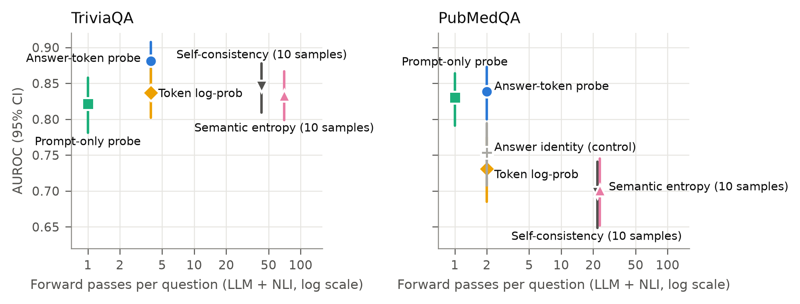
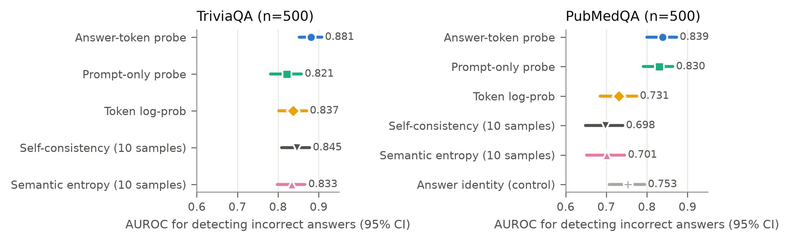

<!-- AUTO-GENERATED from README.template.md by src/report.py. Edit the template. -->
# Cheap Hallucination Detection with Hidden-State Probes

Can a single linear probe on an LLM's hidden state catch hallucinated answers as well as
expensive sampling-based methods like semantic entropy? We test this on
**Qwen2.5-3B-Instruct** (plus a 4-bit 7B replication) on TriviaQA and PubMedQA, running
everything on one 12 GB laptop GPU. We measure accuracy and real cost, include the
controls these comparisons often skip, and report what doesn't work as well as what does.

## Headline result

On the same 500 questions per dataset, a logistic-regression probe on the **last answer
token** detects incorrect answers with **AUROC 0.881** (TriviaQA) and
**0.839** (PubMedQA). That **beats semantic entropy with 10 samples**
(0.833 / 0.701; paired-bootstrap Δ +0.048 [+0.016, +0.085] and
+0.138 [+0.090, +0.186]) while adding **0.8 ms** per question instead of
**337.0 ms** (TriviaQA). A probe that reads only the **prompt**, before any token
is generated, reaches **0.821**, statistically tied with 10-sample semantic entropy
(Δ -0.012 [-0.049, +0.027]) at 6.8 ms instead of 361.1 ms.



## Results (Qwen2.5-3B-Instruct, 500 questions per dataset)

AUROC for detecting incorrect answers, with 95% bootstrap CIs. **+ms** is the measured
latency added on top of generating the answer (RTX 4080 Laptop GPU, same batching for
every method). The prompt-only probe shows its full cost in parentheses, because it runs
*before* generation. Probe scores are out-of-fold (5-fold cross-fitting by question).

| Method | TriviaQA AUROC [95% CI] | +ms | PubMedQA AUROC [95% CI] | +ms |
|---|---|---|---|---|
| **Answer-token probe (ours)** | **0.881** [0.852, 0.908] | 0.8 | **0.839** [0.800, 0.873] | 1.8 |
| **Prompt-only probe (ours)** | 0.821 [0.781, 0.858] | (6.8) | 0.830 [0.791, 0.864] | (57.6) |
| Token log-prob (mean) | 0.837 [0.802, 0.870] | 0.0 | 0.731 [0.685, 0.775] | 0.0 |
| Answer identity (control) | — | — | 0.753 [0.708, 0.794] | 0.0 |
| Self-consistency, 5 samples | 0.823 [0.787, 0.858] | 87.6 | 0.669 [0.624, 0.712] | 311.5 |
| Self-consistency, 10 samples | 0.845 [0.809, 0.878] | 149.7 | 0.698 [0.649, 0.741] | 588.9 |
| Semantic entropy, 5 samples | 0.817 [0.782, 0.854] | 169.2 | 0.671 [0.624, 0.715] | 327.3 |
| Semantic entropy, 10 samples | 0.833 [0.799, 0.867] | 337.0 | 0.701 [0.652, 0.745] | 610.9 |
| Semantic entropy, 10 samples, lenient | 0.835 [0.802, 0.869] | 342.6 | 0.702 [0.655, 0.747] | 611.7 |

Model accuracy: TriviaQA 42.6% (n=2,000), PubMedQA 61.6% (n=1,000).



## What else we found

**It is not a lucky split.** Over 5 random 70/15/15 splits (layer and regularization
chosen on validation only), the answer-token probe scores 0.896 ± 0.011 on TriviaQA
(token log-prob: 0.840 ± 0.015). A 200-permutation shuffled-label control averages
0.505 (TriviaQA) and 0.497 (PubMedQA): no leakage.

**PubMedQA needs an answer-identity control.** Errors depend heavily on which word the
model says (it is usually wrong when it says "maybe"). Predicting errors from the
yes/no/maybe word alone already gives 0.753. The probes beat this control
(Δ +0.085 [+0.053, +0.117]). The extra signal comes mostly from
spotting wrong "no" answers: within "no" answers the prompt probe scores 0.789.

**Accuracy probes vs. Semantic Entropy Probes (Kossen et al., 2024)**, trained on the same
500 questions. In-domain, accuracy probes match or beat SE probes. Out of domain the
result depends on direction, consistent in part with Kossen et al.'s claim that SE probes
generalize better.

| Setting | Token | Accuracy probe | SEP | Δ (accuracy − SEP) [95% CI] |
|---|---|---|---|---|
| TriviaQA (in-domain) | prompt | 0.772 | 0.759 | +0.013 [-0.021, +0.052] |
| TriviaQA (in-domain) | answer | 0.821 | 0.784 | +0.037 [-0.003, +0.079] |
| PubMedQA (in-domain) | prompt | 0.793 | 0.752 | +0.041 [+0.007, +0.075] |
| PubMedQA (in-domain) | answer | 0.842 | 0.754 | +0.088 [+0.046, +0.130] |
| TriviaQA → PubMedQA | prompt | 0.533 | 0.599 | -0.066 [-0.123, -0.010] |
| TriviaQA → PubMedQA | answer | 0.743 | 0.642 | +0.101 [+0.063, +0.142] |
| PubMedQA → TriviaQA | prompt | 0.469 | 0.473 | -0.004 [-0.066, +0.059] |
| PubMedQA → TriviaQA | answer | 0.612 | 0.721 | -0.108 [-0.174, -0.040] |

**Cross-domain transfer is fragile.** A probe trained on TriviaQA and tested on PubMedQA
ranges from 0.573 to 0.766 AUROC depending on
the layer. The layer that is best in-domain (layer 24: 0.611) is not the one
that transfers best (layer 28: 0.766).

| Train → test | Prompt-only probe | Answer-token probe |
|---|---|---|
| TriviaQA → TriviaQA (in-domain) | 0.837 [0.794, 0.882] | 0.909 [0.875, 0.938] |
| PubMedQA → PubMedQA (in-domain) | 0.827 [0.751, 0.896] | 0.828 [0.747, 0.898] |
| TriviaQA → PubMedQA | 0.741 [0.653, 0.823] | 0.540 [0.448, 0.637] |
| PubMedQA → TriviaQA | 0.496 [0.429, 0.561] | 0.577 [0.515, 0.641] |

**7B replication (4-bit NF4).** Same questions, prompts and protocol:

| | TriviaQA 3B | TriviaQA 7B (4-bit) | PubMedQA 3B | PubMedQA 7B (4-bit) |
|---|---|---|---|---|
| Model accuracy | 42.6% | 53.2% | 61.6% | 62.1% |
| **Answer-token probe (ours)** | 0.881 | 0.889 | 0.839 | 0.870 |
| **Prompt-only probe (ours)** | 0.821 | 0.824 | 0.830 | 0.852 |
| Token log-prob (mean) | 0.837 | 0.846 | 0.731 | 0.519 |
| Self-consistency, 10 samples | 0.845 | 0.840 | 0.698 | 0.616 |
| Semantic entropy, 10 samples | 0.833 | 0.830 | 0.701 | 0.615 |

## What does *not* work, or needs care

- **Transfer.** Probes need in-domain labels. Choosing the layer on source-domain data
  does not reliably find a layer that transfers.
- **Prompt-only on PubMedQA.** The last prompt token's final layer *produces* the
  one-word answer, so "before answering" there means "before the answer is emitted". The
  long abstract also makes the time saving small.
- **Token log-prob on 7B PubMedQA** is close to chance: the 7B model hedges with "maybe"
  and is about as confident when hedging as when not.
- **Short answers only.** Semantic entropy was designed for, and may do better on,
  longer generations.

## Reproduce

```bash
python -m venv .venv && .venv/Scripts/activate        # Windows; use .venv/bin/activate on Linux
pip install torch==2.14.1 --index-url https://download.pytorch.org/whl/cu126
pip install -r requirements.txt
bash scripts/run_all.sh                               # 3B pipeline, every step cached and resumable
HP_CONFIG=config_7b.yaml bash scripts/run_all.sh      # 7B (4-bit) replication into results_7b/
python -m src.report                                  # regenerates paper/numbers.tex, tables, this README
```

Every number in this README and in `paper/main.tex` is generated from
`results/metrics.json` by `src/report.py` (this file is rendered from
`README.template.md`).

**Hardware and runtime.** RTX 4080 Laptop GPU (12 GB), Windows 11, Python 3.12, PyTorch
2.14 (CUDA 12.6). Generation, sampling and NLI took about **15 GPU-minutes**
for 3B (peak 9.5 GB) and **26 GPU-minutes** for 7B in 4-bit (peak
9.3 GB). Probe training runs on CPU.

## Repository layout

```
config.yaml / config_7b.yaml   every setting (seed 42)
src/data.py         dataset sampling + prompt formatting
src/generate.py     greedy answers, per-token log-probs, hidden states, sampled answers
src/label.py        correctness labels (SQuAD-normalized alias match; yes/no/maybe parsing)
src/baselines.py    token log-prob, self-consistency, semantic entropy (5/10 samples, strict/lenient)
src/probe.py        probes, layer sweep, prompt-only, transfer, shuffled control, SEP comparison
src/timing.py       clean per-stage latency on an idle GPU
src/evaluate.py     AUROC + bootstrap CIs, abstention curves, cost accounting
src/plots.py        figures (PDF + PNG)
src/report.py       paper macros, tables and this README from metrics.json
NOTES.md            plain-English explanation of every step and decision
paper/main.tex      4-page workshop-style write-up
```

## Limitations

One model family; two short-answer datasets. Labels come from string matching: noisy
TriviaQA aliases cause some false positives and formatting differences some false
negatives (not quantified; see `NOTES.md`). PubMedQA test splits are small
(150 questions), so its CIs are wide. The PubMedQA prompt was adjusted once, using
only the answer distribution on 100 questions, before any labels existed. The 7B model is
4-bit quantized, which may perturb hidden states. Full discussion: `NOTES.md` and the
paper's Limitations section.
