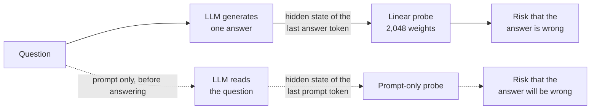

# LLM Hallucination Detector

**Catching an LLM's wrong answers from a single hidden state: more accurate than semantic entropy, with ~{{TqSpeedup}}× less added latency.**

A linear probe reads one internal activation of the model and predicts whether the answer
it just gave is wrong. On Qwen2.5 (3B, and a 4-bit 7B replication), across 3,000 trivia
and biomedical questions, it beats semantic entropy, a leading sampling-based method, on accuracy at a
fraction of the cost. Everything runs on a single 12 GB laptop GPU.

📄 **Paper:** [`paper/main.pdf`](paper/main.pdf) (4 pages) · 🧪 **Every number here is generated from** [`results/metrics.json`](results/metrics.json)

---

## Highlights

| | TriviaQA | PubMedQA |
|---|---|---|
| **Hidden-state probe** (ours), AUROC | **{{TqAucProbeAns}}** | **{{PmAucProbeAns}}** |
| Semantic entropy, 10 samples, AUROC | {{TqAucSEten}} | {{PmAucSEten}} |
| Difference (paired bootstrap, 95% CI) | {{TqDProbeAnsvsSEten}} {{TqDCiProbeAnsvsSEten}} | {{PmDProbeAnsvsSEten}} {{PmDCiProbeAnsvsSEten}} |
| Added latency per question: probe vs. semantic entropy | **{{TqOverProbeAns}} ms** vs. {{TqOverSEten}} ms | **{{PmOverProbeAns}} ms** vs. {{PmOverSEten}} ms |

- 🎯 **More accurate and far cheaper.** The probe beats semantic entropy and
  self-consistency (both with 10 samples), and every difference is statistically
  significant.
- ⏱️ **Predicts errors before the model answers.** From the prompt alone, the probe reaches
  **{{TqAucProbePrompt}}** on TriviaQA, statistically tied with 10-sample semantic entropy, at
  {{TqMsProbePrompt}} ms instead of {{TqMsSEten}} ms.
- 📈 **Holds at 7B.** With Qwen2.5-7B (4-bit), the probe scores {{SvTqAucProbeAns}} vs. {{SvTqAucSEten}}
  for semantic entropy on TriviaQA (Δ {{SvTqDProbeAnsvsSEten}} {{SvTqDCiProbeAnsvsSEten}}).
- 🧯 **Practical payoff.** If the model answers only the half of TriviaQA questions the probe
  is most confident about, accuracy rises from {{TqAccAll}}% to {{TqHalfAccProbeAns}}%.


---

## How it works



**Semantic entropy**, the baseline, asks the model the same question 10 more times, groups
the answers by meaning with an NLI model (DeBERTa-large-MNLI), and scores disagreement.
That is accurate but costs about 10 extra generations plus NLI calls per query.

**The probe** is a logistic regression on the model's residual stream at one layer. Because
it is linear, it can only work if the model already represents "I'm probably wrong"
internally. It costs one dot product (microseconds) on an activation the model computes
anyway.

---

## Results

AUROC for detecting incorrect answers on the **same 500 questions per dataset**, with 95%
bootstrap CIs (Qwen2.5-3B-Instruct). **+ms** is measured latency added on top of
generating the answer (RTX 4080 Laptop GPU, identical batching for every method). The
prompt-only probe shows its full cost in parentheses, since it runs *before* generation.

{{TABLE:main}}

Model accuracy: TriviaQA {{TqAcc}}% (n={{TqN}}), PubMedQA {{PmAcc}}% (n={{PmN}}).

<p align="center"></p>

**3B vs. 7B (4-bit NF4).** Same questions, prompts and protocol:

{{TABLE:scale}}

---

## Rigor: why these numbers can be trusted

- **No leakage.** Train, validation and test splits are disjoint by question (asserted in
  code). Layer and regularization are chosen on validation only. A 200-permutation
  shuffled-label control averages **{{TqShufProbeAns}}** (TriviaQA) and **{{PmShufProbeAns}}**
  (PubMedQA), i.e. chance.
- **Not a lucky split.** Over 5 random splits the probe scores {{TqRobProbeAns}} on TriviaQA
  (token log-prob: {{TqRobLogProb}}).
- **Fair comparison.** All methods are scored on the same questions. Probe scores are
  out-of-fold via 5-fold cross-fitting. Differences use a paired bootstrap.
- **Strong baselines.** Semantic entropy was strengthened to 10 samples, and a lenient
  clustering variant was tested too. Costs are measured wall-clock, not estimated.
- **Confounds controlled.** On PubMedQA (yes/no/maybe), *which word* the model says
  predicts errors well on its own ({{PmAucAnsId}} AUROC). The probe beats this
  answer-identity control (Δ {{PmDProbeAnsvsAnsId}} {{PmDCiProbeAnsvsAnsId}}).

<p align="center"></p>

---

## What doesn't work (reported honestly)

- **Cross-domain transfer is fragile.** A probe trained on TriviaQA and tested on PubMedQA
  ranges from {{TrSweepTqtoPmProbeAnsMin}} to {{TrSweepTqtoPmProbeAnsMax}} AUROC depending on the
  layer. The best in-domain layer ({{TrSweepTqtoPmProbeAnsSel}}) is not the one that transfers
  best ({{TrSweepTqtoPmProbeAnsBest}}). Probes need in-domain labels.
- **Token probability can fail completely.** On PubMedQA, the 7B model hedges with "maybe"
  and is about as confident when hedging as when not, so token log-prob drops to
  {{SvPmAucLogProb}} (near chance).
- **"Before answering" has limits.** For PubMedQA's one-word answers, the last prompt token
  already *produces* the answer, so the prompt-only probe there predicts before the answer
  is emitted, not before it is decided.
- **Semantic Entropy Probes** ([Kossen et al., 2024](https://arxiv.org/abs/2406.15927)) were
  compared at matched training data. Our accuracy probes match or beat them in-domain;
  out of domain the winner depends on direction ([`results/tables.md`](results/tables.md)).

---

## Reproduce

```bash
python -m venv .venv && .venv/Scripts/activate        # Windows; use .venv/bin/activate on Linux/macOS
pip install torch==2.14.1 --index-url https://download.pytorch.org/whl/cu126
pip install -r requirements.txt

HP_CONFIG=config_7b.yaml bash scripts/run_all.sh      # optional: 7B (4-bit) replication -> results_7b/
bash scripts/run_all.sh                               # 3B pipeline -> results/, figures/, paper/, README.md
```

Each step caches its outputs and resumes after a crash. Hardware: RTX 4080 Laptop GPU
(12 GB), Python 3.12, PyTorch 2.14 (CUDA 12.6). Generation, sampling and NLI took about
**{{GpuThreeMin}} GPU-minutes** for 3B (peak {{VramThree}} GB VRAM) and **{{GpuSevenMin}} GPU-minutes**
for 7B in 4-bit (peak {{VramSeven}} GB). Probe training runs on CPU.

<details>
<summary><b>Repository layout</b></summary>

```
config.yaml / config_7b.yaml   every setting (seed 42)
src/data.py         dataset sampling + prompt formatting
src/generate.py     greedy answers, token log-probs, hidden states, sampled answers
src/label.py        correctness labels (SQuAD-normalized alias match; yes/no/maybe parsing)
src/baselines.py    token log-prob, self-consistency, semantic entropy (5/10 samples, strict/lenient)
src/probe.py        probes, layer sweep, prompt-only, transfer, shuffled control, SE-probe comparison
src/timing.py       clean per-stage latency on an idle GPU
src/evaluate.py     AUROC + bootstrap CIs, abstention curves, cost accounting
src/plots.py        figures (PDF + PNG)
src/report.py       paper numbers/tables and this README, generated from metrics.json
NOTES.md            plain-English explanation of every step and design decision
paper/main.tex      4-page workshop-style write-up (compiled: paper/main.pdf)
```
</details>

## Limitations

One model family (Qwen2.5) and two short-answer datasets; semantic entropy was designed
for, and may do better on, longer generations. Correctness labels come from string
matching: noisy TriviaQA aliases cause some false positives, and formatting differences
some false negatives. PubMedQA test splits are small ({{PmTestN}} questions), so its CIs are
wide. The PubMedQA prompt was adjusted once, using only the answer distribution on
{{PilotN}} questions, before any correctness labels existed. The 7B model is 4-bit
quantized. Details: [`NOTES.md`](NOTES.md) and the paper's Limitations section.

## Built with

PyTorch · Hugging Face Transformers & Datasets · bitsandbytes · scikit-learn · matplotlib ·
Qwen2.5-3B/7B-Instruct · DeBERTa-large-MNLI · TriviaQA · PubMedQA
